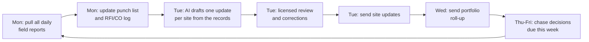

# Multi-Site Project Management Cadence

How I keep many sites moving at once without a site going quiet. Frequencies below are an illustrative standard; the customer's contract cadence wins when it differs.

## 1. Cadence at a glance

| Cadence | What | Owner (role) | Audience | Output |
|---|---|---|---|---|
| Daily | Field notes, readings and photos captured before leaving site | Field Technician | Project Manager | Daily field report |
| Daily | Open-item and emergency check across all active sites | Project Manager | Internal | Updated punch list tracker |
| Weekly | One-page status update per active site | Project Manager, reviewed by the licensed manager for the scope | Facilities Manager, Store Manager | [Weekly status update](../templates/weekly-status-update.md) |
| Weekly | Portfolio roll-up: all sites in one table | Project Manager | Facilities Manager (regional) | Roll-up table (below) |
| Weekly | RFI and change-order log review: anything waiting on a decision | Project Manager | Facilities Manager | [RFI / CO log](../templates/rfi-change-order-log.csv) |
| Monthly | Service-level sign-off for maintained systems | Mechanical Manager / Licensed Plumbing Manager | Facilities Manager | [Spec-to-Service Record](../templates/spec-to-service-record.md), Section 3 |
| Monthly | Document register review: revisions due, superseded documents archived | Project Manager | Internal | [Document register](../templates/document-register.csv) |
| Per project | Turnover package and acceptance | Licensed manager for the scope | Facilities Manager | [Turnover checklist](../templates/turnover-commissioning-checklist.md) |
| Quarterly | Lessons learned across sites: repeat failures, repeat RFIs | Project Manager | Facilities Manager | Short memo with evidence |

## 2. Weekly flow

## 3. Portfolio roll-up (illustrative sample)

| Site | Scope | Status | Next milestone | Decision waiting on | Open safety items |
|---|---|---|---|---|---|
| Retail Store #0000, Anytown OR | Restroom remodel plumbing | At risk | Fixture set | CO-0000-03 (Facilities Manager) | 0 |
| Retail Store #0001, Anytown OR | RTU replacement | On schedule | RTU-3 set | None | 0 |
| Retail Store #0002, Anytown OR | Boiler replacement | Closeout | Turnover acceptance | Acceptance form (Facilities Manager) | 0 |

All rows are illustrative samples.

## 4. Where AI helps in the cadence

- Turning a week of daily field reports into a one-page update per site.
- Building the roll-up table from the per-site updates, so the numbers match.
- Spotting items that have been "pending" for more than one cycle and flagging them for a chase.
- Finding the same failure at more than one site (same part, same age) for the quarterly memo.

In every case the AI works from the records, and the licensed reviewer checks the output against the records before it goes out.
