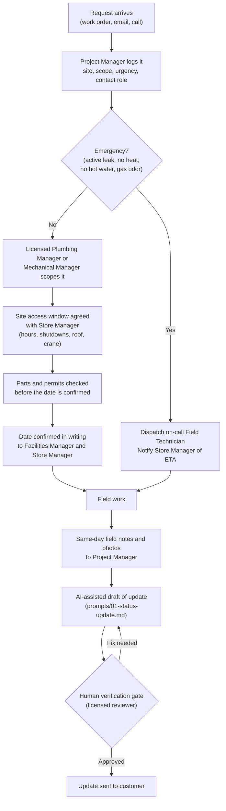

# Scheduling and Handoff Workflow

How a facility work request becomes scheduled work, and how it is handed between roles without losing information. All examples are illustrative.

## 1. Request to scheduled work

## 2. Rules for scheduling at an operating store

1. Work that affects customers (water off, restroom closed, cooling off on the sales floor, noise, roof crane) is scheduled with the Store Manager first, then confirmed to the Facilities Manager.
2. A date is not confirmed until parts are on hand or have a tracked delivery date, and the permit is issued if one is needed.
3. Shutdowns are confirmed again 48 hours ahead (illustrative standard; use the customer's).
4. If a date slips, the customer hears it from us before the original date, with the new date and the reason.

## 3. Handoffs between roles

Each handoff has a written record. The receiving role confirms they have it.

| From (role) | To (role) | What is handed over | Record |
|---|---|---|---|
| Project Manager | Field Technician | Scope, site contact role, access window, parts list, permit number | Work order |
| Field Technician | Project Manager | Field notes, readings, photos, open items | Daily field report |
| Field Technician | Licensed Plumbing Manager / Mechanical Manager | Test results needing licensed review | Test record |
| Project Manager | Facilities Manager | Status, decisions needed | Weekly status update |
| Licensed Plumbing Manager / Mechanical Manager | Commissioning Agent | Start-up records, test results, sequence of operations | Commissioning package |
| Project Manager | Facilities Manager | Turnover package, warranty start date | Turnover letter and acceptance form |
| Field crew (shift end) | Next crew | Work state, isolated systems, lockouts in place, hazards | Shift handoff note |

## 4. Shift and crew handoff note (minimum content)

- What systems are isolated or out of service right now, and where they are isolated
- What is temporary (temporary valve, temporary heat, bypass)
- What is safe to restore and what is not
- Open items and who owns them
- Store contact role and any commitments made to the store today
