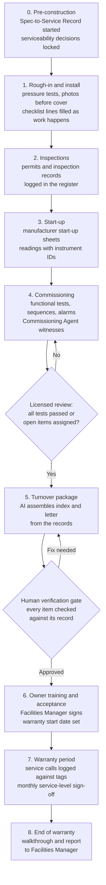

# Turnover Handoff Workflow: Install to Warranty

How a plumbing, HVAC/R or hydronic job moves from installation through commissioning, closeout and warranty. The turnover checklist starts at rough-in, so the package is built during the job instead of at the end.

## 1. Stages

## 2. Stage gates

| Stage | Exit condition | Approver (role) | Record |
|---|---|---|---|
| 0. Pre-construction | Serviceability checklist signed | Mechanical Manager / Licensed Plumbing Manager | Spec-to-Service Record, Section 1 |
| 1. Install | Tests done before anything is covered; photos taken | Licensed manager for the scope | Test records, photos |
| 2. Inspections | All required inspections passed | Licensed manager for the scope | Inspection records |
| 3. Start-up | Start-up sheets complete with instrument IDs | Mechanical Manager | Start-up sheets |
| 4. Commissioning | Functional tests passed or open items assigned | Commissioning Agent | [Commissioning report](../templates/commissioning-report.md) |
| 5. Turnover package | Every checklist line Done or N/A with reason | Licensed manager for the scope | [Turnover checklist](../templates/turnover-commissioning-checklist.md) |
| 6. Acceptance | Acceptance form signed | Facilities Manager | Signed acceptance form |
| 7. Warranty | Claims logged and closed | Project Manager | Service log |
| 8. End of warranty | Walkthrough report delivered | Licensed manager for the scope | End-of-warranty report |

## 3. What goes in the turnover package

- Turnover letter ([example](../examples/before-after/02-turnover-closeout-letter.md))
- Completed turnover and commissioning checklist
- Commissioning report
- Equipment list with tags, makes, models and serials
- Manufacturer manuals and warranty registrations
- As-builts with isolation points
- Permits and inspection records
- Training sign-in sheet
- Punch list with owner roles and dates
- Acceptance form for signature

## 4. Warranty handling

1. Claim comes in with site and equipment tag.
2. Project Manager logs it against the tag in the service log and checks the warranty start date from the signed acceptance form.
3. Workmanship claims go to the licensed manager for the scope. Equipment claims go to the manufacturer through the registration on file.
4. Customer gets a written status within the response time in the contract.
5. Each closed claim is noted on the asset's record, so repeat failures are visible across sites.
